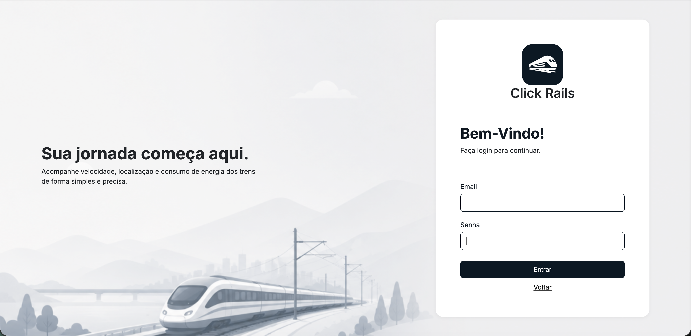
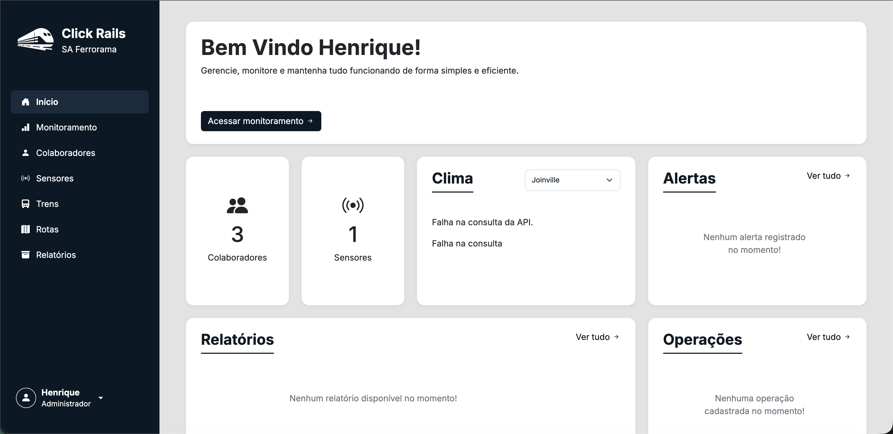
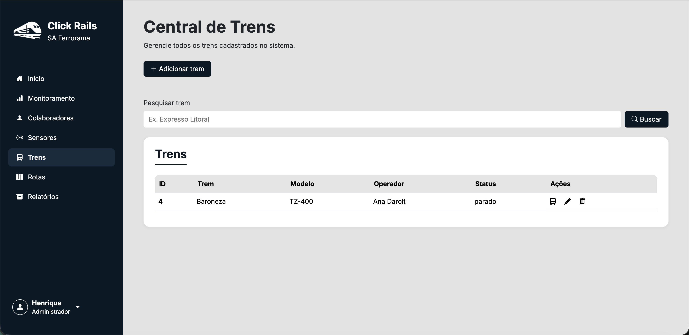
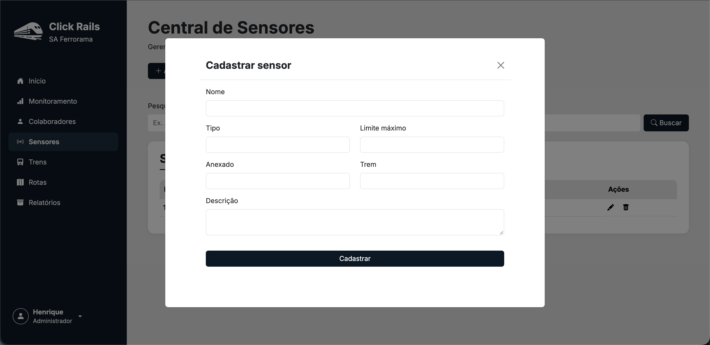

# Manual Rápido de Utilização - Click Rails
 
Este manual explica, passo a passo, como usar o **Click Rails**, o sistema de gerenciamento e monitoramento ferroviário do projeto SA Ferrorama.
Ele foi feito para quem **nunca usou o sistema**, então não é preciso ter conhecimento técnico.
 
---
 
## Sumário
 
1. [Perfis de usuário](#1-perfis-de-usuário)
2. [Como acessar o sistema](#2-como-acessar-o-sistema)
3. [Login e logout](#3-login-e-logout)
4. [Navegando pelo sistema](#4-navegando-pelo-sistema)
5. [Dashboard (tela Início)](#5-dashboard-tela-início)
6. [Colaboradores (usuários)](#6-colaboradores-usuários)
7. [Trens](#7-trens)
8. [Rotas](#8-rotas)
9. [Sensores](#9-sensores)
10. [Monitoramento e operações](#10-monitoramento-e-operações)
11. [Relatórios](#11-relatórios)
12. [Funcionalidades exclusivas do administrador](#12-funcionalidades-exclusivas-do-administrador)
13. [Mensagens de erro comuns](#13-mensagens-de-erro-comuns)
14. [Dúvidas frequentes](#14-dúvidas-frequentes)
---
 
## 1. Perfis de usuário
 
Todo usuário do sistema tem um **cargo**. O cargo define o que a pessoa pode fazer.
 
| Cargo | O que pode fazer |
|---|---|
| **Administrador** | Acesso completo: cadastra, edita e exclui colaboradores, trens, rotas, sensores e relatórios. |
| **Operador** | Consulta trens, rotas e sensores, inicia operações, acompanha o monitoramento e gera relatórios. Pode ser definido como responsável por um trem. |
| **Técnico** | Mesmo acesso de consulta do Operador. |
| **Supervisor** | Mesmo acesso de consulta do Operador. |
 
> Resumindo: **quem não é Administrador consegue consultar, mas não consegue cadastrar, editar ou excluir** colaboradores, trens, rotas e sensores.
 
---
 
## 2. Como acessar o sistema
 
1. Certifique-se de que o sistema está rodando (o XAMPP deve estar com **Apache** e **MySQL** iniciados - veja o `README.md`).
2. Abra o navegador (Chrome, Edge, Firefox etc.).
3. Digite o endereço do sistema. Exemplo:
```
   http://localhost/sa-ferrorama
```
4. A **página de apresentação** do Click Rails será exibida.
5. Clique em **Entrar** (canto superior direito) ou em **Acessar o sistema**.
 
---
 
## 3. Login e logout
 
### 3.1 Como fazer login
 
1. Na tela de login, preencha:
   - **Email**: o e-mail cadastrado para você.
   - **Senha**: a sua senha.
2. Clique em **Entrar**.
3. Se os dados estiverem corretos, você será levado à tela **Início** (dashboard).

 
**Possíveis mensagens na tela de login:**
 
| Mensagem | O que significa | O que fazer |
|---|---|---|
| *Preencha o e-mail e a senha.* | Algum campo ficou vazio. | Preencha os dois campos. |
| *E-mail ou senha incorretos.* | Os dados não conferem. | Confira o e-mail e a senha. Se esqueceu, peça a um Administrador para redefinir sua senha. |
 
### 3.2 Como fazer logout (sair)
 
1. No canto inferior da barra lateral esquerda, clique no **seu nome e cargo**.
2. No menu que abrir, clique em **Sair**.
3. Uma janela de confirmação aparecerá: *"Tem certeza que deseja sair da sua conta?"*
4. Clique em **Sair** para confirmar (ou em **Cancelar** para continuar no sistema).
5. Você voltará para a tela de login.
 
---
 
## 4. Navegando pelo sistema
 
Depois do login, todas as telas têm uma **barra lateral à esquerda** com o menu principal:
 
| Menu | Para que serve |
|---|---|
| **Início** | Dashboard com o resumo geral do sistema. |
| **Monitoramento** | Iniciar e acompanhar as operações dos trens. |
| **Colaboradores** | Cadastro de usuários. *(aparece só para Administrador)* |
| **Sensores** | Cadastro e consulta de sensores. |
| **Trens** | Cadastro e consulta de trens. |
| **Rotas** | Cadastro e consulta de rotas. |
| **Relatórios** | Geração e consulta de relatórios. |
 
O item da tela em que você está fica **destacado** no menu.
 

 
### Padrão das telas de cadastro
 
As telas **Colaboradores, Trens, Rotas, Sensores e Relatórios** funcionam do mesmo jeito:
 
- **Título e descrição** no topo da página.
- **Botão "Adicionar ..."** para cadastrar um novo registro (abre uma janela/formulário).
- **Campo de pesquisa** + botão **Buscar** para encontrar registros.
- **Tabela** com os registros cadastrados.
- **Coluna Ações** com ícones:
  - **Lápis** → Editar
  - **Lixeira** → Excluir
  - Passe o mouse sobre o ícone para ver o nome da ação.
> Para voltar a ver a lista completa depois de uma pesquisa, apague o texto do campo de pesquisa e clique em **Buscar** de novo.
 
---
 
## 5. Dashboard (tela Início)
 
A tela **Início** é a primeira tela após o login. Ela mostra um resumo rápido do sistema.
 

 
### Como interpretar cada informação
 
| Cartão | O que mostra | Como interpretar |
|---|---|---|
| **Boas-vindas** | "Bem Vindo [seu nome]!" e o botão **Acessar monitoramento**. | Confirma quem está logado. O botão leva direto à Central de Monitoramento. |
| **Colaboradores** *(somente Administrador)* | Número total de usuários cadastrados. | Quantas pessoas têm acesso ao sistema. |
| **Trens** *(demais cargos)* | Número total de trens cadastrados. | Para quem não é Administrador, este cartão aparece no lugar de Colaboradores. |
| **Sensores** | Número total de sensores cadastrados. | Quantos sensores existem no sistema (em trens e rotas). |
| **Clima** | Temperatura atual e condição do tempo (ex.: "Céu limpo", "Chuva fraca"). | Use a lista no canto do cartão para trocar a cidade (cidades de Santa Catarina, Joinville é o padrão). Ajuda a avaliar condições que podem afetar a operação. Se aparecer erro, pode ser falta de internet. |
| **Alertas** | Alertas registrados nas operações. | "Nenhum alerta registrado no momento!" significa que está tudo normal. Clique em **Ver tudo** para ir ao Monitoramento. |
| **Relatórios** | Relatórios recentes. | Clique em **Ver tudo** para abrir a Central de Relatórios. |
| **Operações** | Operações de trens em andamento. | Clique em **Ver tudo** para acompanhar no Monitoramento. |
 
> Quando um cartão mostra uma mensagem como *"Nenhum ... no momento!"*, significa apenas que ainda não há dados para exibir, não é um erro.
 
---
 
## 6. Colaboradores (usuários)
 
> **Exclusivo do Administrador.** Os demais cargos não veem este menu.
 
Menu: **Colaboradores** -> tela **Central de Colaboradores**.
 
### 6.1 Cadastrar um colaborador
 
1. Clique em **+ Adicionar colaborador**.
2. Preencha **todos** os campos do formulário:
| Campo | Exemplo | Observação |
|---|---|---|
| Nome | João Pedro da Silva | Nome completo. |
| CPF | 12345678900 | Somente números. Não pode repetir. |
| Data de Nascimento | 15/03/1990 | |
| Gênero | Masculino / Feminino / Outro | |
| Telefone | 47999999999 | |
| Email | joao@empresa.com | Será usado no **login**. Não pode repetir. |
| Senha | ******** | Será usada no **login**. |
| Cargo | Administrador / Operador / Técnico / Supervisor | Define as permissões (veja a [seção 1](#1-perfis-de-usuário)). |
| CEP | 89200000 | Somente números. |
 
3. Clique em **Cadastrar**.
4. O novo colaborador aparecerá na tabela.

> Se algum campo ficar vazio, aparece o aviso **"Preencha todos os campos."** e o cadastro não é feito.
 
### 6.2 Consultar colaboradores
 
- A tabela mostra todos os colaboradores em **ordem alfabética**.
- Para pesquisar, digite no campo **Pesquisar colaborador** e clique em **Buscar**.
- É possível buscar por **nome, CPF, e-mail ou cargo** (ex.: digite "Operador" para ver só os operadores).
### 6.3 Editar um colaborador
 
1. Na linha do colaborador, clique no ícone **Editar**.
2. O formulário abrirá com os dados atuais.
3. Altere o que for necessário.
4. **Senha:** deixe em branco para manter a senha atual, ou digite uma nova para trocá-la.
5. Clique em **Salvar alterações**.
> É assim que o Administrador **redefine a senha** de alguém que esqueceu.
 
### 6.4 Excluir um colaborador
 
1. Clique no ícone **Excluir** na linha do colaborador.
2. Confirme clicando em **Excluir** na janela de confirmação.
**O sistema não permite excluir quando:**
- É a **sua própria conta**: *"Você não pode excluir a sua própria conta."*
- O colaborador é **responsável por algum trem** ou **tem relatórios**: *"Não é possível excluir este colaborador, pois existem trens ou relatórios vinculados a ele."*

Primeiro troque o responsável do trem (veja [7.3](#73-editar-um-trem)) e depois tente novamente.

---
 
## 7. Trens
 
Menu: **Trens** -> tela **Central de Trens**.
 

 
### 7.1 Cadastrar um trem *(somente Administrador)*
 
1. Clique em **+ Adicionar trem**.
2. Preencha:
   - **Nome** - ex.: *Expresso Litoral*.
   - **Modelo** - ex.: *EMD SD70*.
   - **Responsável** - escolha um colaborador da lista. **Só aparecem colaboradores com cargo Operador.**
3. Clique em **Cadastrar**.
 
> Se a lista de **Responsável** estiver vazia, cadastre antes um colaborador com cargo **Operador**.
 
### 7.2 Consultar trens
 
- Todos os usuários podem ver a lista de trens.
- Use **Pesquisar trem** para buscar por **nome, modelo, status ou nome do operador**.
- A coluna **Status** mostra a situação do trem (ex.: *parado*).
- A coluna **Operador** mostra o colaborador responsável pelo trem.
### 7.3 Editar um trem *(somente Administrador)*
 
1. Clique no ícone **Editar** na linha do trem.
2. Altere nome, modelo ou responsável.
3. Clique em **Salvar alterações**.
### 7.4 Excluir um trem *(somente Administrador)*
 
1. Clique no ícone **Excluir** e confirme.
2. Se o trem tiver **sensores vinculados**, aparecerá: *"Não é possível excluir este trem, pois existem sensores vinculados a ele."*
   -> Exclua ou mova os sensores desse trem antes.
### 7.5 Iniciar rota a partir do trem *(todos os usuários)*
 
O ícone **Iniciar Rota** na coluna Ações abre a janela de início de operação já com o trem selecionado. Veja como funciona na [seção 10.1](#101-iniciar-uma-operação).
 
---
 
## 8. Rotas
 
Menu: **Rotas** -> tela **Central de Rotas**.
 
### 8.1 Cadastrar uma rota *(somente Administrador)*
 
1. Clique em **+ Adicionar Rota**.
2. Preencha:
   - **Nome** *(obrigatório)* – ex.: *Rota Principal Joinville – São Francisco*.
   - **Descrição** *(opcional)* – detalhes do trajeto, paradas etc.
3. Clique em **Cadastrar**.
 
### 8.2 Consultar rotas
 
- Todos os usuários podem ver a lista de rotas.
- Use **Pesquisar rota** para buscar pelo **nome ou pela descrição**.
- Usuários que não são Administrador **não veem** a coluna **Ações**.
### 8.3 Editar e excluir rotas *(somente Administrador)*
 
- **Editar**: altere nome e/ou descrição e clique em **Salvar alterações**.
- **Excluir**: confirme a exclusão. Se houver **sensores vinculados** à rota, aparecerá: *"Não é possível excluir esta rota, pois existem sensores vinculados a ela."*
---
 
## 9. Sensores
 
Menu: **Sensores** -> tela **Central de Sensores**.
 
Os sensores podem ser instalados **em um trem** ou **em uma rota** (na via).
 
### 9.1 Entendendo a tabela
 
| Coluna | Significado |
|---|---|
| **ID** | Número de identificação único do sensor. |
| **Sensor** | Nome dado ao sensor. |
| **Tipo** | O que o sensor mede (velocidade, temperatura etc.). |
| **Anexado** | Onde está instalado: **Trem** ou **Rota**. |
| **Vinculado** | Nome do trem ou da rota em que está instalado. |
 
### 9.2 Cadastrar um sensor *(somente Administrador)*
 
> Antes de cadastrar um sensor, o **trem** ou a **rota** onde ele será instalado já precisa existir.
 
1. Clique em **+ Adicionar sensor**.
2. Preencha:
| Campo | Descrição |
|---|---|
| **Nome** | Ex.: *Sensor de velocidade – Expresso Litoral*. |
| **Tipo** | Velocidade, Temperatura, Localização, Vibração, Proximidade ou Freio. |
| **Limite** | Valor de referência do sensor. O nome do campo muda conforme o tipo (veja a tabela abaixo). |
| **Anexado** | Escolha **Trem** ou **Rota**. |
| **Trem / Rota** | Depois de escolher "Anexado", selecione o trem ou a rota específica. |
| **Descrição** | Informações adicionais (opcional). |
 
3. Clique em **Cadastrar**.
**O campo de limite muda de nome conforme o tipo escolhido:**
 
| Tipo do sensor | Nome do campo | Significado |
|---|---|---|
| Velocidade, Temperatura, Vibração, Freio | **Limite máximo** | Valor máximo aceitável. Acima dele, é considerado uma situação de alerta. |
| Proximidade | **Distância mínima** | Menor distância segura permitida. |
| Localização | **Posição na rota** | Ponto da rota onde o sensor está instalado. |


 
> Se faltar **Nome**, **Tipo**, **Anexado** ou o **trem/rota**, aparece **"Preencha todos os campos."** e o sensor não é salvo.
 
### 9.3 Consultar sensores
 
- Todos os usuários podem ver a lista.
- Use **Pesquisar sensor** para encontrar pelo nome, tipo ou trem/rota (ex.: digite "temperatura").
### 9.4 Editar e excluir sensores *(somente Administrador)*
 
- **Editar**: altere os dados e clique em **Salvar alterações**.
- **Excluir**: confirme a exclusão na janela que aparece.
---
 
## 10. Monitoramento e operações
 
Menu: **Monitoramento** -> tela **Central de Monitoramento**.
 
Uma **operação** é uma viagem: um **trem** percorrendo uma **rota**. Aqui você inicia operações e acompanha os dados delas.
 
### 10.1 Iniciar uma operação
 
1. Clique em **+ Iniciar operação** (ou no ícone da tela de Trens).
2. Na janela **Iniciar rota**, escolha:
   - **Trem** que vai operar.
   - **Rota** que ele vai percorrer.
3. Confira o **Início previsto**.
4. Clique em **Iniciar Operação**.
5. A operação é criada com status **em_operacao** e já aparece selecionada no painel.

### 10.2 Selecionar uma operação para acompanhar
 
1. Clique em **Selecionar operação**.
2. Escolha uma das operações da lista (cada uma mostra número, trem, rota e status).
3. Clique em **Selecionar**.

### 10.3 Como interpretar o painel de monitoramento
 
| Cartão | O que mostra |
|---|---|
| **Status** | Situação da operação (ex.: *em_operacao*) e a data/hora de início. |
| **Dados da Operação** | Trem, rota e número da operação selecionada. |
| **Velocidade** | Velocidade do trem informada pelos sensores. |
| **Localização** | Posição do trem na rota. |
| **Alertas** | Ocorrências detectadas (ex.: limite de um sensor ultrapassado). |
| **Últimos registros** | Leituras mais recentes dos sensores. |
 
> Enquanto nenhuma operação estiver selecionada, os cartões mostram *"Selecione uma operação para puxar os dados."*
 
---
 
## 11. Relatórios
 
Menu: **Relatórios** → tela **Central de Relatórios**.
 
### 11.1 Gerar um relatório *(todos os usuários)*
 
1. Clique em **+ Adicionar Relatórios**.
2. Preencha:
   - **Tipo de Relatório**: *Operacional* ou *Sensores*.
   - **Trem**.
   - **Usuário responsável**.
   - **Operação**.
3. Clique em **Gerar Relatório**.
 
> Se aparecer *"Não é possível gerar relatório sem uma operação funcional."*, é preciso existir uma operação válida antes (veja a [seção 10.1](#101-iniciar-uma-operação)).
 
### 11.2 Consultar relatórios
 
- Use **Pesquisar relatório** para buscar pelo **título**.
- Os relatórios aparecem do **mais recente para o mais antigo**.
- O ícone **Visualizar** abre os detalhes do relatório.
### 11.3 Excluir relatórios *(somente Administrador)*
 
Clique no ícone **Excluir** e confirme.
 
---
 
## 12. Funcionalidades exclusivas do administrador
 
| Área | Ação exclusiva do Administrador |
|---|---|
| **Menu** | Ver o item **Colaboradores**. |
| **Dashboard** | Ver o cartão com o total de **Colaboradores**. |
| **Colaboradores** | Cadastrar, consultar, editar, excluir e redefinir senha de usuários; definir o cargo (permissão) de cada um. |
| **Trens** | Cadastrar, editar e excluir trens; definir o operador responsável. |
| **Rotas** | Cadastrar, editar e excluir rotas. |
| **Sensores** | Cadastrar, editar e excluir sensores; definir limites. |
| **Relatórios** | Excluir relatórios. |
 
**O que todos os usuários podem fazer:**
- Fazer login e logout.
- Ver o dashboard.
- Consultar trens, rotas e sensores.
- Iniciar e acompanhar operações no Monitoramento.
- Gerar e visualizar relatórios.

---
 
## 13. Mensagens de erro comuns
 
| Mensagem | Onde aparece | Como resolver |
|---|---|---|
| Preencha o e-mail e a senha. | Login | Preencha os dois campos. |
| E-mail ou senha incorretos. | Login | Confira os dados ou peça ao Administrador para redefinir a senha. |
| Preencha todos os campos. | Formulários de cadastro | Preencha os campos que ficaram vazios. |
| Este CPF já está cadastrado no sistema. | Colaboradores | Já existe um usuário com esse CPF; pesquise por ele. |
| Você não pode excluir a sua própria conta. | Colaboradores | Peça a outro Administrador, se realmente necessário. |
| Existem trens ou relatórios vinculados a ele. | Colaboradores | Troque o responsável dos trens antes de excluir. |
| Existem sensores vinculados a ele/ela. | Trens / Rotas | Exclua ou altere os sensores vinculados antes. |
| Não é possível gerar relatório sem uma operação funcional. | Relatórios | Inicie uma operação antes. |
 
---
 
## 14. Dúvidas frequentes
 
**Esqueci minha senha. O que faço?**
Peça a um Administrador. Ele edita seu cadastro em **Colaboradores** e define uma nova senha.
 
**Não vejo o menu Colaboradores.**
Esse menu é exclusivo do **Administrador**. Se você precisa dele, fale com um Administrador.
 
**Não aparece o botão "Adicionar" em Trens, Rotas ou Sensores.**
Seu cargo não tem permissão de cadastro. Apenas o Administrador cadastra esses itens.
 
**Não consigo escolher um responsável ao cadastrar um trem.**
A lista mostra apenas colaboradores com cargo **Operador**. Cadastre um operador primeiro.
 
**Fui mandado de volta para a tela de login sozinho.**
Sua sessão foi encerrada (por logout ou por ter tentado acessar uma página sem estar logado). Basta entrar novamente.
 
**Qual a ordem ideal para começar a usar o sistema?**
1. Cadastrar os **colaboradores** (incluindo os Operadores).
2. Cadastrar as **rotas**.
3. Cadastrar os **trens** (com seus operadores responsáveis).
4. Cadastrar os **sensores** (nos trens e nas rotas).
5. **Iniciar operações** no Monitoramento.
6. **Gerar relatórios**.
---
 
*Manual elaborado pela equipe de desenvolvimento do Click Rails - SA Ferrorama.*